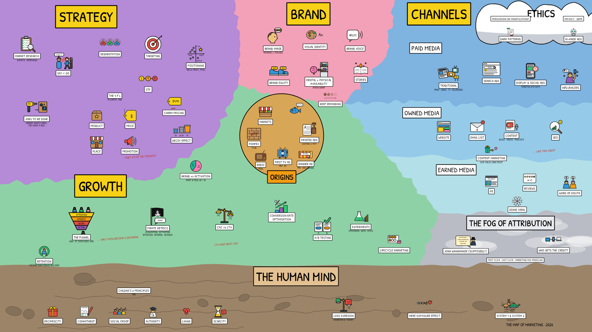
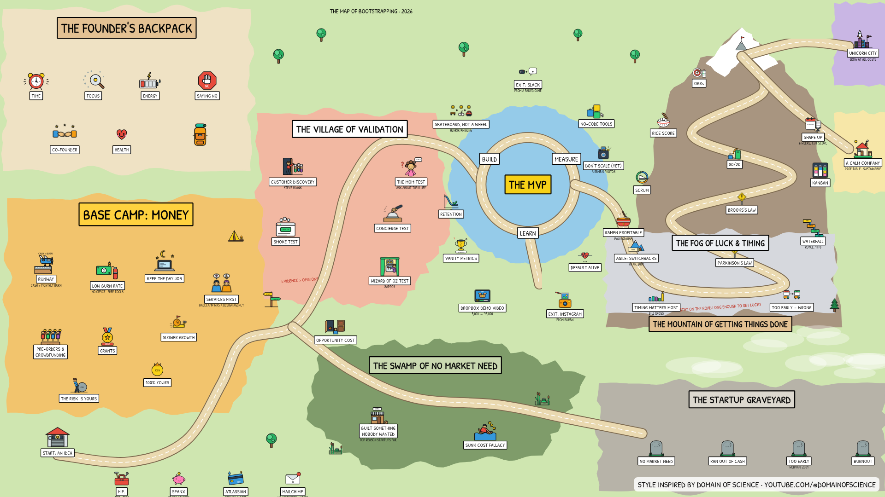

# domain-of

A Claude Code plugin that makes **"Map of X" explainer videos**. A whole field is taught as one illustrated map: coloured territories, cartoon icons, a camera tour, items that pop in as the narrator names them, and a final reveal of the full map.



## Credit

The format is inspired by the **Domain of Science** "Map of X" videos by **Dominic Walliman**. Watch the originals at [youtube.com/@DomainofScience](https://www.youtube.com/@DomainofScience), for example *The Map of Mathematics* and *The Map of Physics*.

This project is an unofficial fan tool. It is not affiliated with or endorsed by Domain of Science. It reuses the *method* (the map metaphor, the pacing, the pop-in reveals), not his artwork: every map and icon is drawn fresh. Each rendered video shows an on-screen credit line, and the skill asks you to credit Domain of Science in the description of any video you publish.

## Install

```text
/plugin marketplace add tupe12334/domain-of
/plugin install domain-of@domain-of
```

Then ask Claude, for example: *"make me a map video about economics in the Domain of Science style"*.

## What is inside

| Path | Purpose |
| --- | --- |
| `skills/map-explainer-video/SKILL.md` | The skill: why the format works, what to make, the order of work, and the quality checks |
| `skills/map-explainer-video/references/` | A style study of Domain of Science map videos, and the script-writing pattern |
| `skills/map-explainer-video/engine/` | The map renderer (browser page + parallel frame capture + ffmpeg), the narration TTS, and the optional music bed |
| `skills/map-explainer-video/icon_library/` | About 70 starter cartoon icons, plus a contact sheet page to browse them |
| `examples/map-of-marketing/` | "The Map of Marketing" (10:47): a broad field drawn as territories on a world map |
| `examples/bootstrapping-journey/` | "The Map of Bootstrapping" (7:53): a process drawn as a road trip, with a swamp, a roundabout, a mountain pass and two destinations |

The two examples show the idea: the style stays the same, and the structure is invented for each subject.



## Requirements

- Node.js and a Chromium or Chrome browser (the renderer uses `playwright-core`)
- ffmpeg
- Python 3 with [kokoro-onnx](https://github.com/thewh1teagle/kokoro-onnx) and its v1.0 model files, for narration
- Optional: `transformers` + `torch` for the MusicGen music bed

## Related projects

- [moadim](https://moadim.io/): loop engineering. Build, schedule and run agent loops.

## License

MIT for the code. The bundled Patrick Hand SC font is under the SIL Open Font License (see `skills/map-explainer-video/engine/fonts/OFL.txt`).
